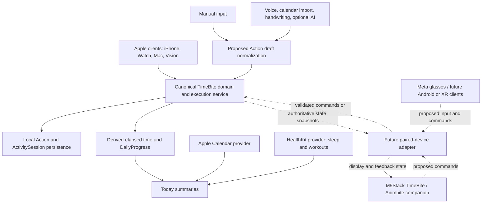

# TimeBite system design architecture

## Scope and current state

`timebite-official` is the canonical Apple application repository. The broader system includes Apple clients, Meta AI glasses, future Android/XR clients, and an M5Stack-based TimeBite / Animbite companion. These clients should share one Action/session/progress contract while keeping platform presentation and hardware implementation separate.

The current repository implements Apple app entry points, shared domain models, a local JSON snapshot store, timestamp-derived sessions, EventKit reads, and a HealthKit provider. M5Stack connectivity, glasses integration, and the external command protocol below are proposed architecture, not implemented features.

## System boundaries



The diagram describes logical boundaries, not an existing shared runtime or transport. Apple apps currently have local stores; a working cross-device relay is not established.

## Canonical domain and execution

The shared chain is Goal → Project → Action → ActivitySession → completion → DailyProgress. Goal and Project remain optional groupings. An Action is the same domain object regardless of whether it originates from typing, speech, an import, AI interpretation, glasses, or M5Stack input.

Persisted session timestamps and active intervals are authoritative for elapsed time. Clients render the projected state; a device display tick must never become the authoritative timer. Daily progress is calculated from canonical persisted execution data. The current ring implementations differ; the proposed MVP calculation is documented in [activity ring semantics](architecture/activity-ring-semantics.md).

## M5Stack / TimeBite / Animbite companion

M5Stack is a companion input/output client. Depending on the eventual hardware, it can display the current Action, elapsed time, running/paused status, and daily progress; physical controls can request start, pause, resume, or complete. New activity input should become a validated Action draft rather than a separate hardware task model.

A future Apple-side paired-device adapter translates transport messages into domain commands and returns authoritative state. Bluetooth, Wi-Fi, or a relay may carry those messages; transport selection is deferred. The local iPhone execution loop must remain usable when the companion is absent or disconnected.

Firmware, display drivers, sensors, robotic behavior, and servo control belong in a separate hardware repository. TimeBite may eventually send high-level feedback state, but this repository does not own motor instructions or physical actuation safety. Animbite's hardware behavior should consume state without changing the meaning of an Action or session.

### Proposed command and state contract

Commands express user intent, using canonical Action IDs:

```json
{
  "version": 1,
  "commandId": "UUID",
  "deviceId": "paired-device-id",
  "type": "action.start",
  "actionId": "UUID",
  "timestamp": "2026-10-08T07:00:00Z"
}
```

The same envelope can represent `action.pause`, `action.resume`, and `action.complete`. The receiving execution service validates the paired sender, Action identity, and legal transition. `commandId` enables duplicate-delivery handling; a repeated command must not create another session or count completion twice. The sender timestamp is metadata, not permission to overwrite the authoritative session clock.

The adapter returns an acknowledgement or rejection and a state projection:

```json
{
  "version": 1,
  "revision": 12,
  "asOf": "2026-10-08T07:15:00Z",
  "activeActionId": "UUID",
  "sessionId": "UUID",
  "status": "running",
  "elapsedSeconds": 900,
  "dailyProgress": 0.42
}
```

`revision` is a proposed projection revision, distinct from the existing per-session revision. After disconnect, the companion marks its display stale. Reconnection fetches a fresh snapshot before sending state-dependent commands. Automatic offline replay is deferred until ordering and conflict rules are defined. Device commands must pass through the same execution boundary as app controls, never write persistence directly.

## Input, AI, Calendar, and Health boundaries

Manual entry is the required baseline. A proposed ActionDraft → validation/normalization → Action boundary should serve all ingestion sources. AI interpretation is optional and provider-independent; it cannot bypass validation or become necessary to start an Action.

Existing EventKit events coexist with Actions as separate Today entries. Preserve functioning Calendar reads; importing an event as an Action would be an explicit future ingestion operation. HealthKit stays behind `TimeBiteHealth`, normalizing real sleep/workout data into summaries. Neither Calendar occupancy nor a hardware signal automatically proves execution.

Raw HealthKit samples, account credentials, and unrelated calendar details are excluded from the default companion projection. Expose only the state required for the selected companion interaction.

## Repository ownership

| Concern | Owner |
|---|---|
| Apple UI and navigation | `Apps/`, `Packages/TimeBiteUI/` |
| Action, Goal, Project, sessions, calculations | `TimeBiteCore/` |
| Canonical local persistence | `Packages/TimeBiteData/` |
| HealthKit queries and sleep normalization | `Packages/TimeBiteHealth/` |
| Existing reconciliation logic | `Packages/TimeBiteSync/`; not a complete device transport |
| Future companion adapter | Apple-side service boundary; not implemented |
| M5Stack/Animbite firmware and actuation | Separate hardware repository |
| Meta/glasses and Android/XR implementations | Separate client repositories using the shared contract |

This architecture documents future compatibility without migrating experimental/admin applications, firmware, AI runtimes, or device networking into the production app.
