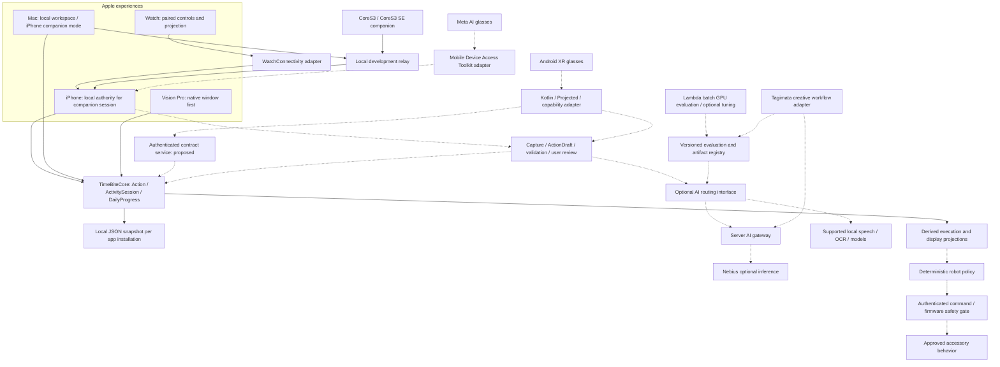
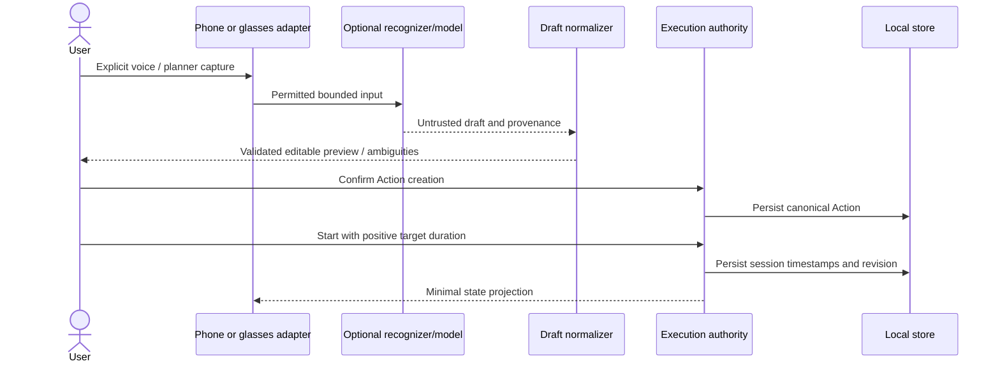
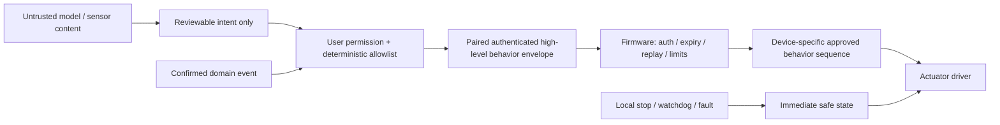

# Shared TimeBite / CYRA architecture

Updated 2026-10-15. This document supersedes the older architecture overview, not the running implementation. **TimeBiteCore.Action is the canonical task model.** New components below are proposals unless the inventory explicitly identifies existing code.

Daily Intent → Action creation → execution sessions → activity rings → reflection remains the product loop. AI, glasses, and robotic feedback are optional. Local manual creation and timer execution must work without a model, provider, companion, or network.

## Verified repository baseline

Inspected GitHub default-branch snapshots for the two TimeBite repositories and selected local CYRA working-tree files, not every file or device build:

| Repository / revision | Evidence | Interpretation |
|---|---|---|
| [timebite-official](https://github.com/erinjerri/timebite-official/tree/8f63494b9923967fbe924fb313be8e9f8b3fe361) | `TimeBiteCore/Models/{Action,ActivitySession,CompanionState}.swift`, `Packages/TimeBiteUI/{CompanionControl,PairedWatchBridge}.swift`, `Packages/TimeBiteSync/SessionReconciler.swift`, `docs/sync.md`, relay README | Production consolidation target; shared Apple domain, local persistence, companion control code, development relay. Signed paired-device transfer remains unverified per sync documentation. |
| [timebite-platform](https://github.com/erinjerri/timebite-platform/tree/52782e6d0d5c749dfd685f71fc800036be4ee074) | `schemas/task_schema.json`, `Shared/`, `docs/{repository-architecture,system-architecture}.md`, planner and assistant files | Earlier architecture and migration source. Task schema is a descriptive legacy shape, not executable JSON Schema. Planner schema/mapper and assistant orchestrator/whitelist inspected are empty placeholders. |
| [CYRA-AgentBeatsHackathon](https://github.com/erinjerri/CYRA-AgentBeatsHackathon/tree/d93dede1907ebe674cc1a001b79cbd7edaf7879c) | `backend/main.py`, `backend/api/tasks.py`, README, `docs/benchmark-design.md` | User-confirmed meaning of `cyra-hackathon`. Local HEAD is the linked revision, but its working tree contains modified/untracked files (including README and app restructuring); findings describe that working tree, not a clean pinned release. FastAPI task capture and evaluation workflow scaffold; `/evaluate` returns fixed 0.98/85ms values. `task_success` is unconditionally true. These are not model quality results. |

The August platform docs call `timebite-platform` canonical; the newer official README and canonical Action contract establish `timebite-official` as the current Apple owner. Keep older repositories as migration references. Do not transplant their server-computed task percentages or Goal-owned sessions over the official Action/session model.

Older official overview/README language says Watch and companion transport are planned. More specific current `docs/sync.md` and source implement WatchConnectivity and a foreground local relay. This document uses that newer evidence while retaining its verification limits.

## Logical system

Solid edges show the existing domain or development companion path. Dashed edges show proposed integrations. A shared contract does not imply a shared cloud runtime.

## Platform adapters

| Platform | Responsibility and boundary | First useful increment |
|---|---|---|
| iOS | Full local execution; permissions, capture, EventKit/HealthKit adapters; current companion authority. Optional Apple Vision/Speech/Core ML and runtime-available Foundation Models. Provider keys stay server-side. | Normalize typed/OCR drafts into Action with review. |
| macOS | Native desktop app using TimeBiteCore. Mac Local Actions are independent today; iPhone Companion mode controls phone-owned state. MLX/Core ML experiments remain behind model interfaces. | Prove companion controls and clarify local versus phone state. |
| watchOS | Glanceable session, rings and explicit controls via paired iPhone; no independent divergent companion task store. WatchConnectivity is not a Mac–Watch transport. | Real paired-device start/pause/resume/complete and reachability QA. |
| visionOS | Native SwiftUI window with canonical tasks/progress; later RealityKit spatial boards. Spatial presentation does not change authority. | Verify windowed app and projection adapter. Camera capture must not assume enterprise main-camera access. |
| Meta AI glasses | Device Access Toolkit in mobile companion supplies permitted input/output; local capability/permission negotiation before every session. Meta AI Connectors are a separate optional integration, not the name for DAT. | Explicit capture → phone preview → approved draft; phone fallback if unavailable. |
| Android XR glasses | Kotlin adapter to the same JSON contracts; distinguish augmented AI/display glasses using Projected/Glimmer from immersive XR devices. Do not assume every glasses device has a display or spatial tracking. | Emulator capture/draft flow and read-only projection; remote mutations wait for authenticated authority service. |
| M5Stack CoreS3 | Embedded display, buttons, optional supported sensors, approved feedback; no large-model runtime. Firmware stays in its hardware repository. Current relay notes refer specifically to CoreS3 SE, whose peripherals must be checked separately. | Display and explicit timer controls before robotic motion. |
| Tagimata Studios | Separate tenant/workflow adapter for product tagging, catalog OCR and creative assets. Reuse inference interfaces, evaluation tooling and artifact handling. | Offline tagging benchmark with separately consented studio data. |

Capability adapter proposal: `capabilities()` returns device/OS/SDK version and available capture, audio, display, local-model and transport features; `capture()` returns a bounded source reference; `submitDraft()` never writes domain state; `sendCommand()` returns pending/applied/rejected; `observeProjection()` exposes stale status. Revoked permission, lost connection, unsupported hardware and model unavailability are normal states with manual/phone fallback.

Current platform documentation supports these capability-based choices: [Meta toolkit and distinct Connectors](https://developers.meta.com/wearables/faq/), [Android augmented experiences](https://developer.android.com/develop/xr/explore/augmented), [Android glasses UI](https://developer.android.com/design/ui/ai-glasses/guides/components/overview), [Foundation Models availability](https://developer.apple.com/documentation/FoundationModels/generating-content-and-performing-tasks-with-foundation-models), [visionOS enterprise camera entitlements](https://developer.apple.com/documentation/visionOS/building-spatial-experiences-for-business-apps-with-enterprise-apis), [CoreS3 hardware](https://docs.m5stack.com/en/core/CoreS3). Checked 2026-10-15; pin and verify actual SDK/device support during implementation.

## Canonical JSON and ingestion

See [contract reference](architecture/action-data-contract.md) and [executable proposed wire schema](../schemas/action.schema.json). Preserve Action names, UUIDs, seconds, lifecycle and execution enums. Preserve ActivitySession timestamps, active intervals and revision. A draft is an ingestion object, never a second persisted Task. No AI output supplies authoritative completion, elapsed time, revision or progress.

Scheduling recommendations remain proposals. Resolve local dates/time zones and ambiguous duration with the user. Calendar writes require an explicit separate operation; existing EventKit reads remain read-only. Health observations and calendar occupancy do not prove task execution. Reflection is proposed as a separate user-authored record linked to Action/session; it must not block completion.

## Authority, sync and offline operation

Current implementation: one iPhone owns the companion session; Watch sends immediately reachable commands. Mac/CoreS3 development relay is RAM-only, role-token protected, local HTTP, and requires foreground iPhone activity. Phone publishes about every five seconds; queued relay controls expire after 30 seconds; projections become stale after 120 seconds or day end. `202` is pending, not executed. No Internet production deployment, durable command queue, or automatic multi-phone handoff is established.

Existing CompanionCommand uses `id`, `type` (`start`, `pause`, `resume`, `complete`), `actionID`, optional `sessionID` and `revision`. Non-start commands check session identity/revision. Applied IDs are bounded to the last 256 in UserDefaults; this is not permanent exactly-once delivery or an atomic command journal. Keep this shape for v1 adapters; do not silently replace it with the earlier illustrative `action.start` envelope.

Proposed production command envelope wraps v1 payload with authenticated principal, paired device, protocol version, authority ID/epoch, expiry and idempotency key. Scope authorization per user/device. Persist command result and domain mutation atomically before returning applied. Reject unknown types, wrong authority, expired/stale revisions and cross-user IDs. Production transport uses TLS and revocable pairing, with secrets in platform secure storage.

Local timers continue offline; companion devices mark cached state stale and do not replay controls on reconnect. Refresh first. Future cross-device continuation needs a single writer lease/epoch and explicit handoff; the old owner must lose write authority before the new owner starts. Partitioned devices cannot both control one authoritative session. `SessionReconciler` is a pure merge policy: completion wins over noncompletion, higher revisions win, equal revisions use event time, competing active sessions are rejected. It is not a transport, authentication layer or safe authority-transfer protocol.

Use persisted active intervals for duration; render ticks locally. Clip totals to local calendar days including daylight saving changes. Completion does not manufacture execution credit. Keep session ring, execution daily ring and merged occupied-time summaries clearly named: current session ring can show 100% on completion even when actual active duration is below target. Preserve that existing distinction rather than deriving daily execution credit from it.

## Robotic command safety boundary

Timer commands and physical behavior commands are separate protocols and permissions. Domain completion may trigger a deterministic, opt-in feedback policy. A model can suggest a named behavior for review, but cannot issue motor angles, PWM, voltages, executable code or arbitrary firmware arguments.

Proposed envelope: `version`, `commandId`, `deviceId`, `authorityEpoch`, monotonic `sequence`, bounded TTL, allowlisted `behaviorId`, bounded `intensity`, bounded `durationMs`, integrity tag. Use per-device authenticated pairing; replay protection and TTL must work without trusting an unsynchronized wall clock. A new connection negotiates session nonce/sequence; expired or previous-session commands are rejected. Duplicate delivery never repeats motion.

Firmware independently verifies command integrity, pairing, behavior availability and calibrated intensity/duration, current/thermal/power constraints, cooldown and maximum duty cycle. Local stop preempts networking and inference; watchdog, malformed commands, link loss and faults enter a defined safe state. No automatic motion replay after reconnect/reset. Acknowledgements distinguish accepted, running, completed and fault. Logs record reason codes without raw audio/images.

No servo sequence is approved by this document. Actual limits depend on actuator, enclosure, battery and child-accessible mechanics. Start with screen/LED feedback; motion stays disabled until the hardware owner documents and bench-verifies calibrated limits, stop behavior, stall handling and disconnect tests. Full CoreS3 versus SE peripherals must be verified against the actual board.

## AI compute and Tagimata reuse

Use a provider-neutral `recognizeSpeech`, `extractText`, `extractActionDraft`, `describeImage` interface with bounded input/output, deadline, cancellation, model version and usage accounting. Keep local recognition available where supported; optional remote requests pass through a server gateway with per-user quotas, timeouts, bounded retries and circuit breaker. Cloud failure preserves the captured draft/manual path. User content and retrieved text are data, never tool authorization.

Lambda is a batch R&D environment for ASR/OCR/VLM comparison, structured extraction evaluation, reviewed synthetic data and conditional LoRA/QLoRA. It is not the timer/sync backend. Promote versioned artifacts and measured results after review; never auto-promote a trained model into production. Use pinned models, licenses, containers and dataset hashes; export results before termination.

Nebius is an optional inference adapter behind the gateway. Verify model-specific modalities, structured output, context and latency before routing; OpenAI-compatible API syntax does not guarantee those capabilities. [Nebius Token Factory](https://dev.nebius.com/token-factory) documents hosted inference; no account access, active credits or model entitlement was verified here. Avoid SDK/provider dependencies inside TimeBiteCore.

Historical $800 Lambda / $50 Nebius amounts are unverified. Before any paid run, record balance, issuance/expiry, eligible products, restrictions, region capacity and current total instance price. Subtract unbilled usage and reserve storage/taxes/retry costs. Budget from the verified amount, not the historical total. Lambda billing runs while instances are idle and ends at termination; filesystems continue billing while they exist. [Billing](https://docs.lambda.ai/public-cloud/billing/), [credit-balance lag](https://docs.lambda.ai/public-cloud/manage-billing/), [promotional terms](https://lambda.ai/legal/terms-of-service) support these gates. No GPU was provisioned or spending authorized by this documentation task.

Suggested gated allocation of verified eligible R&D budget: 10% baseline/pilot, 40% comparisons, 20% error analysis and reviewed synthetic data, 15% conditional tuning, 15% reserve. Release later stages only if the pilot exposes a useful quality gap. For each run, cap hours by `(stage budget - expected storage/tax/reserve) / current total hourly instance price`; choose the smallest available GPU that fits measured model/context/batch memory. A separate external watchdog terminates overdue jobs; verify termination and remaining storage afterward.

Reuse recognizers, gateway interfaces, dataset manifests and artifact/evaluation tools for Tagimata. Use separate studio datasets, access policies, media buckets, model adapters and quality gates for catalog tagging/concept art; product asset jobs do not become TimeBite Actions unless explicitly exported through the draft adapter. Never put private planner/HealthKit or bystander capture into studio training data. Model and asset licenses must allow each intended use. No common user-data pool is implied by shared code.

## Evaluation and rollout

CYRA's `/process` and container workflow offer reusable request fixtures and smoke-test structure. Replace timestamp-second file identity with UUIDs in any production fork; add authentication, tenant isolation, concurrency-safe storage and redacted telemetry before external use. Extracted-text-only inputs need explicit normalization because the current intent/title selection omits `extracted_text`. Do not reuse unconditional success or fixed `/evaluate` output as metrics.

Build a consented, versioned held-out corpus for typed/voice/planner/glasses inputs, ambiguous times, noise, multilingual text, duplicate requests, prompt injection and provider failure. Split by person/document/session to avoid train/test leakage. Measure word/character errors for recognition, exact normalized field accuracy, schema validity, user edit rate, unsupported claims, p50/p95 end-to-end latency and cost per accepted draft. Compare manual/local baseline, small remote model and optional larger quality reference before tuning.

Suggested initial release gates (targets, not measured results): all outputs either validate or return a typed rejection; zero unauthorized mutations/robot activations across adversarial fixtures; >=95% title/duration field accuracy on the initial labeled corpus; p95 draft preview <=5 seconds under the declared device/network test profile. Report sample counts and per-slice failures; adjust latency target only through an explicit product decision. Track human acceptance separately from syntactic validity. Robot faults/replays and sync conflicts use deterministic tests, not an LLM judge.

See the [incremental implementation plan](architecture/implementation-plan.md) for dependencies and completion evidence.
